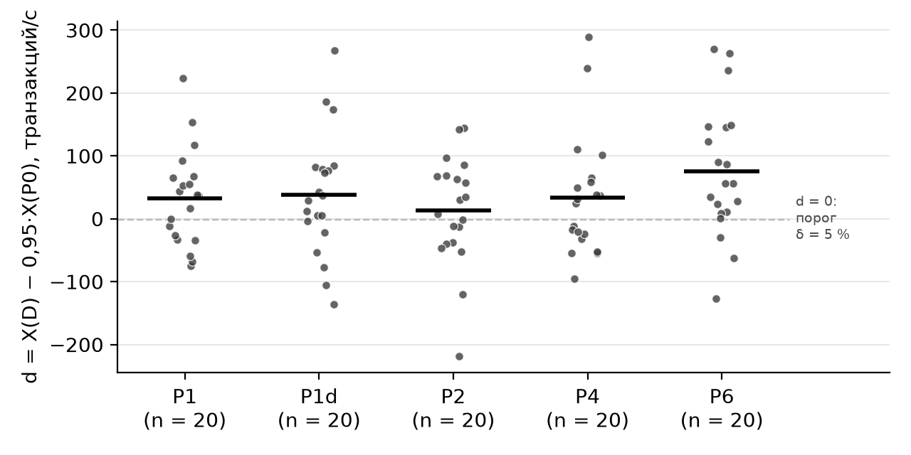

# Дополнительные материалы к статье

«Экспериментальная оценка защитного эффекта и стоимости профилей hardening системных служб Linux средствами systemd». Здесь собраны таблицы и рисунок, вынесенные из текста статьи; в статье на них ссылаются как на табл. S1–S7 и рисунок S1. Все числа относятся к прогону этапа 3 19–20.10.2026 (`data/rerun/`), кроме табл. S7, где он сопоставлен с первым прогоном (`data/main/`). Как получить их заново — `python reproduce.py` (корневой `README.md`).

## Таблица S1 – Микропроверки изоляции по категориям (раздел 5.3)

| Категория | Операции |
|---|---|
| FS | Чтение маркеров в /home и /root; чтение синтетического секрета; создание файла в каталоге внутри /etc |
| DEV | Видимость маркеров хоста в /tmp и /var/tmp; открытие тестового устройства; mknod |
| KER | Запись в sysctl hostname; запись в sysrq‑trigger; запрос размера буфера журнала ядра; запись параметра модуля printk |
| PROC | PTRACE_SEIZE, kill(pid, 0) и чтение /proc/PID/environ для процесса того же пользователя; установка SCHED_FIFO |
| PRIV | setuid; setgid; chroot; запуск SUID‑программы с получением euid = 0 |
| NS | unshare для пространств имён user, network, mount; запись в cgroup.procs |
| NET | Сокеты AF_PACKET, AF_NETLINK, raw ICMP, AF_INET6 |
| ADV | Анонимное отображение RWX; mprotect RW→RX; personality ADDR_NO_RANDOMIZE; установка SUID‑бита на собственный файл |
| X | Создание карты BPF; userfaultfd; io_uring_setup; присоединение к новому сеансовому keyring |

Источник: `scripts_v005/probe_all_v005.sh`; результаты — `data/rerun/raw-vm/probe-v005/`.

## Таблица S2 – Нагрузочные серии этапа 3 (раздел 5.6)

| Серия | Каталог результатов | Служба и профили | Блоков | Принято | Повторено из‑за паузы |
|---|---|---|---|---|---|
| R1 | nginx 20261019‑172537 | Nginx: P0, P1c, P4, P5, P6 | 60 | 300 | 25 |
| R5 | nginx 20261019‑211626 | Nginx: P0, P1, P2, P1r | 60 | 240 | 24 |
| R1д | nginx 20261019‑222428 | Nginx: P0, P4, P6 (добор) | 60 | 180 | 3 |
| R2 | redis 20261019‑184311 | Redis: P0, P1, P2, P1d, P4, P6 | 20 | 120 | 1 |
| R3 | postgresql 20261019‑194432 | PostgreSQL: P0, P1, P2, P1d, P4, P6 | 10 | 60 | 19 |
| R3д | postgresql 20261019‑230632 | PostgreSQL: P0, P1, P2, P1d, P4, P6 (добор) | 10 | 60 | 17 |
| R4 | nginx 20261019‑221621 … ‑222305 | Nginx: P0, P4, пилоты C = 1…16 | 5 × 3 | 30, вне анализа | 1; серия не проведена |
| memcached | memcached 20261020T032709Z | memcached: P0, P2, P4, P6 | 20 | 80 | 0 |

Источник: `data/rerun/raw-vm/<служба>/benchmark-v005/<каталог>/results.csv`, memcached — `data/rerun/memcached/`.

«Повторено из-за паузы» — измерения с паузой метронома длиннее 500 мс, сохранённые отдельно и выполненные заново (`data/rerun/derived/stall_sensitivity.txt`).

## Таблица S3 – Монтирование после запуска службы: 40 ячеек (раздел 6.6)

| Профиль | Достигнута | Заблокирована | Не воспроизведена |
|---|---|---|---|
| P0 (с PrivateMounts) | 5 | 0 | 3 |
| P1r | 2 | 0 | 6 |
| P1c | 0 | 2 | 6 |
| P5 | 0 | 2 | 6 |
| P6 | 2 | 3 | 3 |

Источник: `data/rerun/raw-vm/mount-states-v005/`.

Матрица разведочная и в выбор не входит. Базовым здесь служит P0 с PrivateMounts=yes и распространением монтирования slave, а не P0 нагрузочных серий. «Не воспроизведена» — монтирование не дошло до пространства монтирования службы; это не блокирование.

## Таблица S4 – PostgreSQL: t-границы и точные перестановочные границы при α = 0,005 (раздел 6.7)

| Профиль | Блоков | Среднее и медиана d | Асимм. | L: t / перест. | U: t / перест. | Uc: t / перест. | Исход: t / перест. |
|---|---|---|---|---|---|---|---|
| P1 | 20 | 33 / 37 | 0,7 | −16,1 / −14,4 | +82 / +83 | 0,4 / 0,4 % | не сделан / не сделан |
| P1d | 20 | 38 / 33 | 0,4 | −24,8 / −23,3 | +101 / +101 | 1,6 / 1,6 % | не сделан / не сделан |
| P2 | 20 | 13 / 19 | −0,8 | −42,7 / −43,6 | +69 / +66 | 1,9 / 1,8 % | не сделан / не сделан |
| P4 | 20 | 34 / 28 | 1,3 | −27,2 / −21,6 | +95 / +97 | 1,5 / 1,4 % | не сделан / не сделан |
| P6 | 20 | 76 / 56 | 0,3 | +8,3 / +8,8 | +143 / +144 | 1,9 / 1,8 % | неухудшение / неухудшение |

Источник: `data/rerun/derived/pg_contrasts.csv`, `scripts_v005/pg_contrasts.py`.

Перестановочные границы — по всем 2ⁿ сменам знаков парных контрастов; предполагают симметрию контраста, но не нормальность. Распределение контрастов — рисунок S1.

## Таблица S5 – Пилоты серии R4 ниже насыщения: загрузка процессора службой под P0 (раздел 6.8)

| Соединений C | 1 | 2 | 4 | 8 | 16 |
|---|---|---|---|---|---|
| Загрузка, минимум–максимум по трём блокам | 97,6–97,7 % | 98,7–98,8 % | 98,7–98,8 % | 98,6 % | 98,6 % |

Источник: `data/rerun/raw-vm/nginx/benchmark-v005/20261019-221621` … `-222305`.

Условие серии — загрузка 40–70 % — не выполнено ни при одном C, и серия по протоколу не проводилась.

## Таблица S6 – Выбор при 24 порядках диагностических критериев, число порядков (раздел 6.9)

| Служба | H = 2 % | H = 5, 10, 15 % |
|---|---|---|
| Nginx | P1c – 24 | P1c – 24 |
| Redis | P1d – 24 | P6 – 16, P1d – 8 |
| PostgreSQL | P6 – 24 | P6 – 24 |

Источник: `data/rerun/analysis-final/policy24.csv`, `order-sensitivity.txt`.

## Таблица S7 – Два прогона этапа 3 (раздел 7)

| Показатель | Первый прогон, Ryzen 5 2600 | Второй прогон, Ryzen 5 3600 |
|---|---|---|
| Принято измерений / повторено из-за пауз | 1000 / 51 | 960 / 89 |
| Nginx: X(P0) в R1, запросов/с | 12 159 | 17 853 |
| Nginx: потеря P1c / P4 / P5 / P6 | 0,6 / 5,5 / 6,2 / 5,4 % | 0,6 / 5,5 / 6,1 / 5,4 % |
| Nginx: Uc P1c при M = 7 | 2,02 % | 1,05 % |
| Nginx: P1c − P5, P1c − P6, запросов/с | +682, +577 | +976, +907 |
| Redis: потеря P1d / P6 | 0,4 / 2,9 % | 0,2 / 2,7 % |
| PostgreSQL: X(P0), транзакций/с; загрузка службы | 881; 70–73 % | 759; 36–39 % |
| PostgreSQL: неухудшение подтверждено | P1, P2, P1d | P6 |
| Разрешено в P0 микропроверок: рабочий / главный процесс | 19 / 35 | 18 / 35 |
| Выбор B с политикой, H = 2 %: Nginx, Redis, PostgreSQL | P1r, P1d, P1d | P1c, P1d, P6 |
| Выбор B с политикой, H = 5–15 %: Nginx, Redis, PostgreSQL | P1c, P6, P1d | P1c, P6, P6 |
| memcached, выбор B с политикой | не измерен | P4 (B: P2, P4, P6 – равенство) |

Источник: `data/main/` (первый прогон, AMD Ryzen 5 2600), `data/rerun/` (прогон статьи, AMD Ryzen 5 3600).

Первый прогон выполнен теми же авторами по протоколу, зафиксированному локально; очередь прогона статьи собрана после знакомства с его данными.

## Рисунок S1 – PostgreSQL: парные контрасты блоков d = X(D) − 0,95·X(P0) (раздел 6.7)

Точки — блоки серий R3 и R3д, черта — среднее; d > 0 соответствует потере меньше порога 5 %. Источник: `data/rerun/derived/pg_contrasts.csv`.
